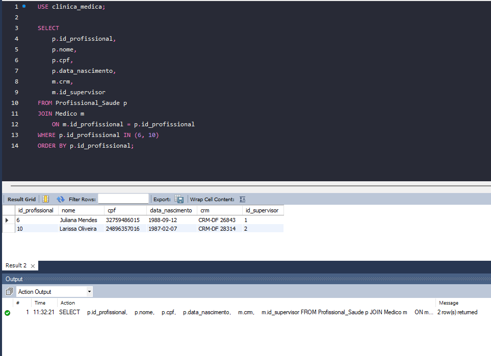
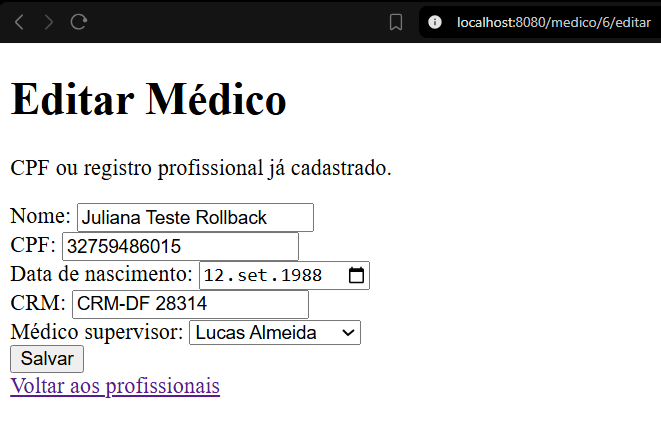
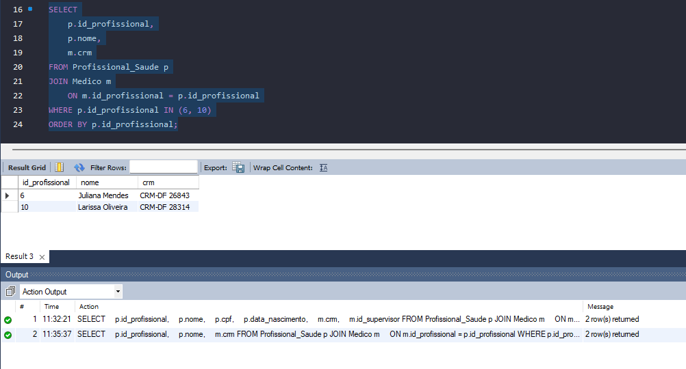
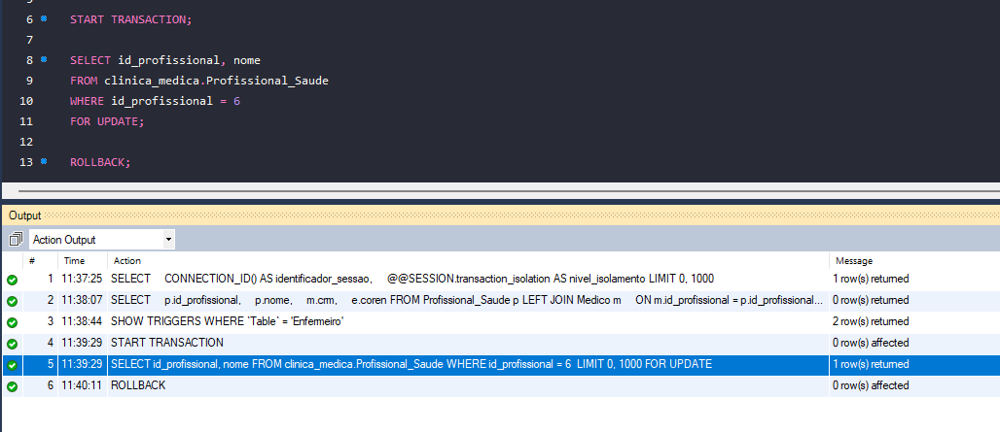
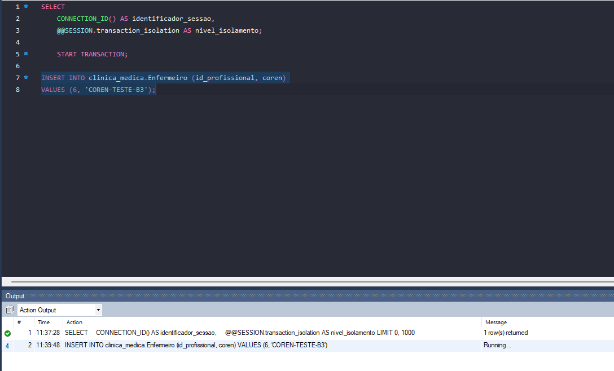
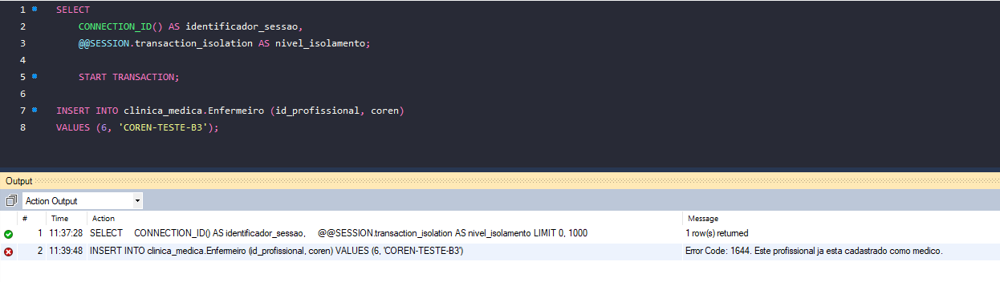
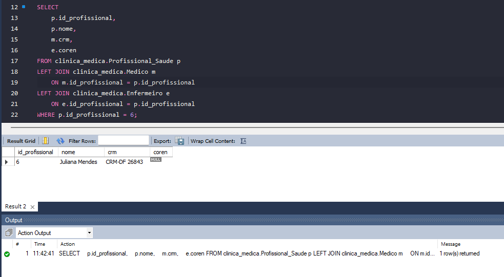

# Testes manuais — Etapa 2

Organização atualizada em 18/10/2026, com base nas capturas fornecidas e nos testes relatados durante o desenvolvimento. A organização deste documento não representa uma nova execução da aplicação.

## Como ler os resultados

- **Documentado:** há capturas que sustentam o resultado descrito.
- **Parcial:** a captura demonstra somente parte do teste ou pertence a uma versão anterior.
- **Relatado, sem captura:** o resultado foi informado durante os testes, mas a evidência não veio neste conjunto.
- **Pendente:** falta executar, repetir ou reunir evidências suficientes.

As imagens estão em `evidencias/`. O [índice das capturas](indice-evidencias.md) inclui todos os arquivos recebidos. Capturas antigas foram preservadas, mas não devem ser usadas como prova de fluxos removidos na versão atual.

## B1 — Funcionalidades da aplicação

### Pacientes

| Teste | Resultado e limite da evidência | Situação | Evidência |
| --- | --- | --- | --- |
| Listagem | Tela apresenta pacientes e total de 40 registros na captura de 13/10; não comprova todos os fluxos CRUD | Parcial | [Listagem](<evidencias/Captura de tela 2026-10-13 233757.png>) |
| Cadastro, edição, validações e exclusão | Fluxos testados durante o desenvolvimento; não há sequência específica dessas operações neste conjunto | Relatado, sem captura | Pendente de anexar |

### Profissionais, médicos e enfermeiros

| Teste | Resultado e limite da evidência | Situação | Evidência |
| --- | --- | --- | --- |
| Abertura do cadastro de médico | Formulário disponível; a imagem está vazia e não comprova gravação ou igualdade dos IDs | Parcial | [Formulário](evidencias/Cadastro-de-medico.png) |
| Cadastro de médico nas duas tabelas | Falta capturar o sucesso e a consulta que mostra o mesmo ID na base e na especialização | Pendente | — |
| Cadastro com CRM duplicado | Falta repetir/documentar a rejeição e a ausência do novo profissional após rollback | Pendente | — |
| Edição com CRM duplicado | Nome e CRM originais preservados no banco após falha na segunda atualização | Documentado | [Antes](evidencias/b3-rollback-antes.png), [tentativa](evidencias/b3-rollback-tentativa-rejeitada.png), [depois](evidencias/b3-rollback-depois.png); procedimento no B3 |
| Abertura do cadastro de enfermeiro | Formulário vazio disponível; não comprova cadastro nem edição bem-sucedidos | Parcial | [Formulário](evidencias/cadastro-de-enfermeiro.png) |
| Cadastro e edição bem-sucedidos de enfermeiro | A listagem mostra Bob cadastrado, mas não documenta a sequência de criação e edição | Parcial | [Listagem](evidencias/listagem-enfermeiros-com-bob.png) |
| CPF duplicado na edição de enfermeiro | Tentativa de usar em Bob o CPF de Carlos foi rejeitada; ao reabrir, o CPF original de Bob permaneceu | Documentado | [Original](evidencias/edicao-enfermeiro-bob-dados-originais.png), [CPF de Carlos](evidencias/edicao-enfermeiro-carlos-cpf-existente.png), [rejeição](evidencias/edicao-enfermeiro-bob-cpf-duplicado-rejeitado.png), [preservado](evidencias/edicao-enfermeiro-cpf-preservado.png) |
| Exclusão completa de profissional de teste | Falta confirmar a ausência nas tabelas base e de especialização depois da exclusão | Pendente | — |
| Exclusão de médico com consulta | Captura mostra bloqueio no antigo fluxo “Remover como médico”; repetir no fluxo atual de exclusão completa | Parcial, histórica | [Bloqueio antigo](<evidencias/exclusão-de-medico-com-consulta.png>) |
| Exclusão de profissional com evolução clínica | Tela antiga mostra bloqueio por vínculos; a mensagem não identifica sozinha qual vínculo causou a rejeição | Parcial, histórica | [Bloqueio](<evidencias/exclusão-de-profissional-com-evolução-clinica.png>) |
| Filtro de supervisor | O próprio médico ficou fora das opções ao abrir a edição e após erro de CRM duplicado | Relatado, sem captura | Pendente de anexar |

O teste de CPF duplicado na edição não comprova, sozinho, rollback entre duas tabelas: a falha pode ocorrer já no primeiro `UPDATE`. Para a atomicidade multitabela, utilizar o teste de CRM duplicado do B3.

### Outros CRUDs

| Funcionalidade | Situação das evidências neste conjunto |
| --- | --- |
| Especialidades | Não foram recebidas capturas específicas de cadastro, edição, duplicidade e exclusão |
| Medicamentos | Ajustes de validação e erros foram delegados; conclusão e testes ainda precisam ser conferidos |
| Vínculos médico–especialidade | Código revisado anteriormente; faltam evidências da execução. Validação amigável da data na edição foi adiada |

### Consulta parametrizada — resumo por médico e período

Filtros: médico opcional, data inicial e final obrigatórias. A consulta relaciona `Medico`, `Profissional_Saude` e `Consulta`, com `COUNT` e `SUM`. O período considera `Consulta.data_hora`, incluindo todos os horários do último dia. Médicos sem consultas permanecem no resultado por causa do `LEFT JOIN`.

| Teste | Resultado observado | Situação | Evidência |
| --- | --- | --- | --- |
| Todos os médicos, 01/01/2026 a 31/12/2026 | Tela apresenta médicos e totais; conferência com Workbench foi relatada, sem captura SQL neste conjunto | Documentado na interface | [Todos os médicos](evidencias/resumo-consultas-todos-medicos.png) |
| Juliana no mesmo período | Somente Juliana, com 4 consultas e valor total de R$ 800,00 | Documentado | [Filtro por Juliana](evidencias/resumo-consultas-filtro-juliana.png) |
| Período invertido | Data inicial 20/01/2026 e final 19/01/2026: mensagem de validação, sem resultados | Documentado | [Período inválido](evidencias/resumo-consultas-periodo-invertido.png) |
| Período sem consultas | Juliana em 20/01/2026: quantidade 0 e valor 0,00 | Documentado | [Resultado zero](evidencias/resumo-consultas-periodo-sem-consultas.png) |

Os valores representam consultas registradas, não pagamentos recebidos. O modelo não possui status que permita afirmar que todas as consultas foram realizadas.

### Segunda consulta parametrizada e relatório com VIEW

| Item | Estado registrado |
| --- | --- |
| Prescrições por medicamento e período | SQL testado com todos e com um medicamento, mantendo as contagens. Implementação Java/HTML orientada; não há confirmação final dos testes da tela nem capturas neste conjunto |
| Relatório com VIEW | Implementação delegada a outro integrante; aguarda integração e evidências |

Para a segunda tela, registrar todos os medicamentos, medicamento específico, período invertido e período sem prescrições. Para o relatório, anexar a definição da VIEW, consulta direta e tela que a utiliza.

## B2 — Parametrização e resistência à injeção SQL

O código revisado utiliza parâmetros nas operações discutidas. Isso deve ser acompanhado do teste exigido de tentativa de injeção SQL, com entrada utilizada, resultado esperado, resultado observado e evidência. Esse teste não está documentado nas imagens recebidas.

**Situação: pendente de documentação do experimento.** Não confundir os filtros de pesquisa do B1 com uma demonstração de resistência à injeção SQL.

## B3 — Transações e concorrência

### Operação transacional e limites da transação

O método `atualizar` de `ProfissionalSaudeRepository` utiliza `@Transactional`. Na edição de médico, executa os comandos nesta ordem, na mesma transação:

```sql
-- Início da transação: gerenciado pelo Spring.

UPDATE Profissional_Saude
SET nome = ?, cpf = ?, data_nascimento = ?
WHERE id_profissional = ?;

UPDATE Medico
SET crm = ?, id_supervisor = ?
WHERE id_profissional = ?;

-- Retorno normal do método: COMMIT gerenciado pelo Spring.
-- Exceção de duplicidade propagada pelo método: ROLLBACK pelo Spring.
```

Esse bloco representa a sequência lógica; não é um script para executar diretamente no Workbench. O `JdbcTemplate` envia os valores como parâmetros. O controle transacional não é escrito explicitamente no método Java.

A violação de unicidade do CRM gera `DuplicateKeyException`. Como a exceção sai do repository, o Spring desfaz a transação antes de o controller tratar a falha e apresentar a mensagem. A finalidade é impedir que os dados pessoais sejam atualizados sem a correspondente atualização dos dados de médico.

O método `criar` também usa `@Transactional`: insere em `Profissional_Saude`, recupera a chave gerada e insere em `Medico` ou `Enfermeiro`. O teste de edição abaixo é a evidência principal de falha induzida desta versão do documento.

### Teste de falha induzida — 18/10/2026

**Estado inicial:**

| ID | Nome | CRM |
| --- | --- | --- |
| 6 | Juliana Mendes | CRM-DF 26843 |
| 10 | Larissa Oliveira | CRM-DF 28314 |

**Procedimento:**

1. Consultar os registros no Workbench e guardar o estado inicial.
2. Abrir `/medico/6/editar` na aplicação.
3. Trocar o nome por `Juliana Teste Rollback` e o CRM por `CRM-DF 28314`, mantendo os demais campos.
4. Salvar e observar a mensagem de duplicidade.
5. Consultar novamente os dois registros no banco.

```sql
SELECT p.id_profissional, p.nome, m.crm
FROM Profissional_Saude p
JOIN Medico m ON m.id_profissional = p.id_profissional
WHERE p.id_profissional IN (6, 10)
ORDER BY p.id_profissional;
```

**Resultado:** Juliana permaneceu com o nome `Juliana Mendes` e o CRM `CRM-DF 26843`; Larissa permaneceu inalterada. Considerando a ordem dos comandos do repository, a preservação do nome demonstra que a primeira atualização foi revertida quando o CRM duplicado provocou a falha na segunda tabela.







### Isolamento observado na aplicação e justificativa

Foi executado pela aplicação `SELECT @@SESSION.transaction_isolation` em um método temporário com `@Transactional(readOnly = true)`. O resultado informado foi `REPEATABLE-READ`. Não foi recebida captura desse diagnóstico neste conjunto.

Os métodos `criar` e `atualizar` não declaram isolamento explícito e usam o padrão da conexão. O resultado é a configuração observada no ambiente testado, não uma garantia de que qualquer instalação terá o mesmo padrão. O método de diagnóstico já não consta no repository enviado para revisão.

**Justificativa da escolha:** manter `REPEATABLE-READ` permite uma visão consistente nas leituras comuns de uma transação, após a criação de seu snapshot. Para os fluxos de escrita entre profissional e especialização, a atomicidade depende de `@Transactional`, e a coordenação das inserções incompatíveis depende também do bloqueio explícito do registro base e das verificações dos triggers. O isolamento, sozinho, não garante exclusividade nem totalidade da especialização. Transações curtas reduzem o tempo durante o qual outras operações podem ficar esperando.

As leituras com `FOR UPDATE` são leituras com bloqueio e não devem ser descritas como simples leituras do snapshot. O teste abaixo avalia esse mecanismo; não compara todos os níveis de isolamento.

### Concorrência — teste principal de 18/10/2026

**Objetivo:** observar a espera por bloqueio e a rejeição da tentativa de inserir como enfermeiro uma profissional que já é médica.

**Ambiente e pré-condições:**

- Duas conexões independentes, informadas como sessão A = 43 e sessão B = 45.
- Juliana Mendes, ID 6, já cadastrada em `Medico`.
- Presença do trigger `trg_enfermeiro_exclusivo_insert` conferida antes do teste.
- InnoDB havia sido verificado nos testes anteriores. Não há nova captura de engine neste conjunto.
- Os IDs foram informados pelo executor; as capturas atuais mostram a execução da consulta de identificação, mas não sua grade com isolamento e IDs. Não se presume, apenas pelo diagnóstico da aplicação, o isolamento de cada sessão do Workbench.

**Sessão A — comandos efetivamente registrados:**

```sql
START TRANSACTION;

SELECT id_profissional, nome
FROM clinica_medica.Profissional_Saude
WHERE id_profissional = 6
FOR UPDATE;

-- Executado somente após iniciar a tentativa na sessão B:
ROLLBACK;
```

**Sessão B — tentativa registrada:**

```sql
INSERT INTO clinica_medica.Enfermeiro (id_profissional, coren)
VALUES (6, 'COREN-TESTE-B3');
```

O editor da sessão B contém `START TRANSACTION`, mas seu histórico não mostra a execução desse comando. Portanto, não se afirma que a sessão B abriu uma transação explícita nem se presume seu autocommit. O `ROLLBACK` de encerramento da sessão B foi orientado, mas não consta nas capturas recebidas.

**Sequência observada:**

| Momento | Evento |
| --- | --- |
| 11:39:29 | Sessão A inicia transação e executa o bloqueio do registro 6 |
| 11:39:48 | Sessão B inicia o INSERT; captura mostra `Running...` |
| 11:40:11 | Sessão A executa ROLLBACK e libera o bloqueio |
| Após a liberação | A tentativa recebe erro 1644: “Este profissional ja esta cadastrado como medico.” |
| Verificação final | ID 6 continua médica, CRM-DF 26843, COREN NULL |

O horário do INSERT no Output indica o início do comando; não deve ser usado como horário da conclusão. Não foi medido um tempo exato de espera nem observado deadlock.







**Consulta de verificação final:**

```sql
SELECT p.id_profissional, p.nome, m.crm, e.coren
FROM clinica_medica.Profissional_Saude p
LEFT JOIN clinica_medica.Medico m
    ON m.id_profissional = p.id_profissional
LEFT JOIN clinica_medica.Enfermeiro e
    ON e.id_profissional = p.id_profissional
WHERE p.id_profissional = 6;
```



**Interpretação:** a sessão A manteve o registro base bloqueado. A tentativa na sessão B precisou aguardar sua liberação; depois, o trigger rejeitou a especialização incompatível. Trata-se de bloqueio e rejeição de uma profissional que já era médica, não de duas criações simultâneas de especialização. O ROLLBACK da sessão A apenas encerrou o bloqueio; a demonstração de reversão de alterações em duas tabelas é o teste de edição anterior.

### Situação documental do B3

Estão reunidos a operação multitabela, sua sequência e fronteiras transacionais, a falha induzida com verificação no banco, o experimento de concorrência e a justificativa do isolamento observado na aplicação.

Para completar a rastreabilidade, anexar a captura do diagnóstico de isolamento da aplicação e das grades com ID/isolamento das duas sessões. Uma nova medição deve receber sua própria data: não substitui retroativamente a configuração não capturada no experimento de 18/10. Caso ainda haja transação de teste aberta no Workbench, encerrá-la com `ROLLBACK` na conexão correspondente.

## Integridade da especialização — apoio ao modelo e ao B3

O MER define especialização total e exclusiva de `Profissional_Saude` em `Medico` e `Enfermeiro`.

### Comportamento atual

- A aplicação cadastra profissional e especialização na mesma transação.
- Foram removidos os fluxos de cadastro sem especialização e exclusão isolada da especialização.
- A exclusão completa respeita os vínculos impeditivos e remove a especialização por cascata.
- Triggers `BEFORE INSERT` rejeitam a dupla especialização e utilizam bloqueios para coordenar inserções.
- Triggers `BEFORE UPDATE` rejeitam a alteração direta do identificador nas tabelas de especialização.

| Verificação | Alcance da evidência | Evidência |
| --- | --- | --- |
| Quatro triggers instalados | Confirma a existência no momento da captura | [Triggers](<evidencias/Conferir criação de gatilhos.png>) |
| Diagnóstico sem violações | Consulta retornou zero linhas naquele momento; não é uma garantia permanente | [Diagnóstico](<evidencias/Identificar profissionais sem especialização ou com as duas.png>) |
| Exclusividade nos dois sentidos | Erro 1644 ao tentar inserir enfermeiro como médico e médico como enfermeiro | [Rejeições](<evidencias/impedir que um medico seja enfermeiro ou vice-versa.png>) |
| Imutabilidade direta dos IDs | Erro 1644 nas duas tabelas, com ROLLBACK registrado | [Atualizações rejeitadas](<evidencias/Impedir alteração direta do ID do medico ou enfermeiro.png>) |

A totalidade é mantida pelos fluxos da aplicação, não por restrição global no banco. SQL direto autorizado ainda pode inserir base sem especialização ou excluir somente a especialização. Os triggers de atualização não interceptam ações `ON UPDATE CASCADE`. Os triggers de integridade não substituem os de auditoria exigidos pelo B6.

## B4 a B8 — evidências ainda não incluídas neste conjunto

| Artefato | O que reunir |
| --- | --- |
| B4 — desempenho | Três consultas, EXPLAIN antes/depois, índices justificados, volume e tempos medidos |
| B5 — segurança | Perfis, GRANT/REVOKE, testes de acesso permitido/negado, VIEW restritiva e autenticação/proteção de dados exigidas |
| B6 — auditoria | Definições e testes dos triggers de auditoria, com autoria, data e valores anteriores/novos |
| B7 — armazenamento e recuperação | Análise de tipos/crescimento, política de backup/retenção e restauração testada |
| B8 — entrega consolidada | Incorporar análises e evidências ao relatório final, declaração de uso de IA e roteiro da demonstração |

A ausência de capturas aqui não afirma ausência de implementação: o ZIP SQL enviado anteriormente já continha arquivos chamados `05_triggers.sql` e `06_seguranca_e_controle_de_acesso.sql`. Seu conteúdo e testes não foram avaliados nesta organização.

## Histórico preservado

O experimento anterior usou o profissional 32 e as sessões 10/74, com liberação por COMMIT, conforme relato original. Ele é separado do teste de 18/10, que usa o ID 6 e liberação por ROLLBACK. Na nova base consultada, o ID 32 não foi encontrado.

- [Concorrência anterior — sessão A](evidencias/concorrencia-sessao-a-bloqueio.png)
- [Concorrência anterior — sessão B](evidencias/concorrencia-sessao-b-rejeicao.png)
- [Concorrência anterior — estado final](evidencias/concorrencia-resultado-final.png)
- [Antigo cadastro genérico com CPF duplicado](evidencias/CPF-duplicado-no-cadastro-de-profissional.png): fluxo removido, não comprova o cadastro atual de médico/enfermeiro.
- [Profissional mantido após exclusão isolada](<evidencias/profissional-mantido-no-banco-mesmo-apos-exclusão-de-especialização.png>): comportamento removido.
- [Arquivo originalmente chamado “Profissional e médico com o mesmo ID”](<evidencias/Profissional-e-medico-com-o-mesmo ID.png>): a imagem mostra uma edição rejeitada por duplicidade, e não uma consulta dos IDs. Por isso, não foi usada para comprovar igualdade de identificadores.

As demais capturas auxiliares e antigas estão no [índice completo](indice-evidencias.md).

## Pendências para a próxima atualização

1. Anexar sucesso de cadastro de médico com o mesmo ID nas duas tabelas, rollback do cadastro com CRM duplicado e exclusão completa.
2. Complementar evidências atuais dos demais CRUDs, do filtro de supervisor e das exclusões bloqueadas.
3. Confirmar os testes da segunda tela parametrizada e do relatório com VIEW.
4. Anexar os diagnósticos de isolamento e identificação de sessões, distinguindo a data de cada medição.
5. Incluir o teste de injeção SQL e os experimentos dos demais artefatos conforme forem realizados.
