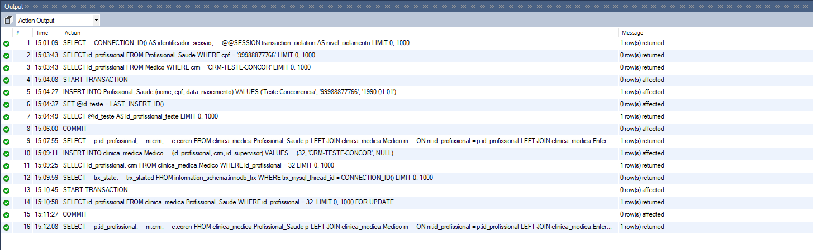
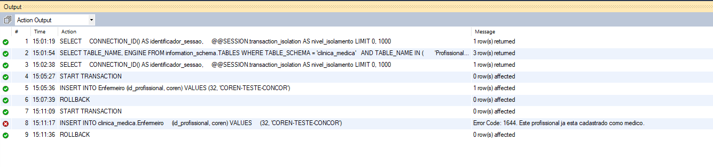
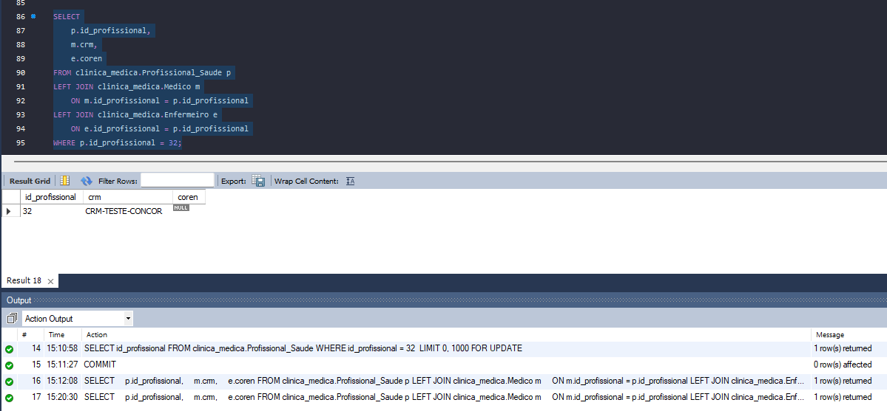

# Testes manuais — Etapa 2

| Teste | Resultado observado | Evidência |
| --- | --- | --- |
| Cadastro de médico | Profissional e médico cadastrados com o mesmo ID | |
| Cadastro com CRM duplicado | Mensagem de erro e rollback do novo profissional | |
| Edição com CRM duplicado | Nome e CRM originais preservados no banco | |
| Exclusão de médico com consulta | Operação bloqueada com mensagem na interface | |
| Cadastro e edição de enfermeiro | Dados gravados e recuperados corretamente | |
| Remoção da especialização de enfermeiro | Profissional mantido no banco | |
| Exclusão de profissional com evolução clínica | Operação bloqueada | |
| CPF duplicado no cadastro e edição de profissional | Mensagem de erro e campos preservados | |

## Concorrência — exclusividade de especialização

**Objetivo:** verificar a espera por bloqueio e impedir que um
profissional já cadastrado como médico seja inserido como enfermeiro.

**Ambiente:**
- MySQL com tabelas InnoDB.
- Duas conexões independentes: sessões 10 e 74.
- Isolamento REPEATABLE READ em ambas.

**Procedimento:**
1. O profissional 32 já estava cadastrado como médico.
2. A sessão A iniciou uma transação e bloqueou seu registro em
   Profissional_Saude com SELECT ... FOR UPDATE.
3. A sessão B iniciou outra transação e tentou inserir o ID 32
   em Enfermeiro.
4. A inserção ficou aguardando.
5. A sessão A executou COMMIT.
6. A sessão B recebeu a mensagem:
   "Este profissional ja esta cadastrado como medico."
7. A sessão B foi encerrada com ROLLBACK.

**Resultado observado:** houve espera por bloqueio, seguida da
rejeição da especialização incompatível. Não foi observado deadlock
neste experimento.

**Interpretação:** as leituras com FOR UPDATE coordenaram o acesso
ao registro do profissional. A rejeição foi feita pelo gatilho;
não é uma garantia fornecida isoladamente pelo nível REPEATABLE READ.

### Sessão A — bloqueio e liberação

### Sessão B — rejeição da dupla especialização

### Estado final do profissional

## Especialização de profissionais — total e exclusiva

O MER define a especialização de Profissional_Saude em Medico e
Enfermeiro como total e exclusiva: todo profissional deve possuir
exatamente uma dessas especializações.

### Totalidade na aplicação

- O cadastro exige a escolha entre médico e enfermeiro.
- O profissional base e sua especialização são inseridos na mesma
  transação.
- Uma falha na inserção da especialização provoca rollback.
- A exclusão pela aplicação remove o profissional base e sua
  especialização, respeitando os vínculos existentes.
- Foram removidos os fluxos de cadastro sem especialização e de
  exclusão isolada da especialização.

### Exclusividade no banco

- Gatilhos BEFORE INSERT rejeitam a inclusão de um profissional
  em uma especialização quando ele já pertence à outra.
- Gatilhos BEFORE UPDATE impedem alterações diretas do
  id_profissional nas tabelas Medico e Enfermeiro.
- As verificações de inserção utilizam leituras com bloqueio
  para coordenar operações concorrentes.

### Testes realizados

- Diagnóstico dos dados sem violações após as correções.
- Rejeição de dupla especialização.
- Rejeição de alteração direta do ID de médico.
- Rejeição de alteração direta do ID de enfermeiro.
- Experimento com duas sessões: espera por bloqueio seguida de
  rejeição da especialização incompatível.

### Limites da solução

A totalidade é mantida pelos fluxos da aplicação, não por uma
restrição global do banco. Um usuário com permissões para executar
SQL direto ainda pode criar um profissional sem especialização ou
excluir somente sua especialização.

Os gatilhos de atualização protegem alterações diretas nas tabelas
de especialização; ações ON UPDATE CASCADE não acionam esses gatilhos.

Esses gatilhos são de integridade e não substituem os gatilhos
de auditoria exigidos pelo artefato B6.
